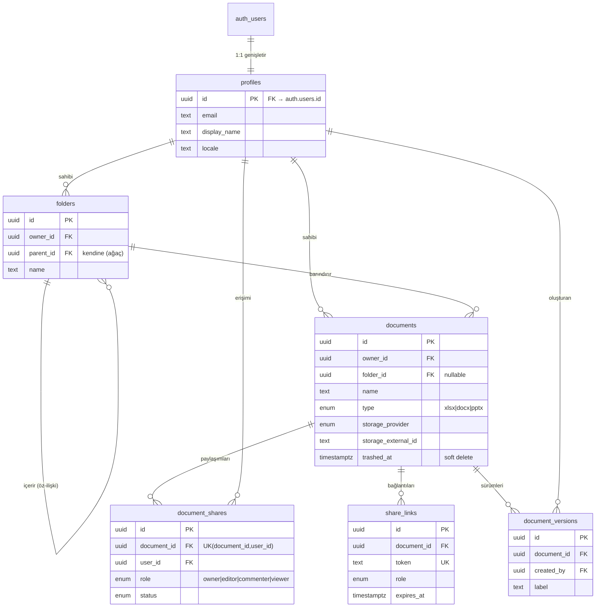

# UniTEAM — Veritabanı Şeması (ER Diyagramı + Açıklama)

Gerçek SQL: [`db/schema.sql`](../db/schema.sql). Bu belge şemayı **görsel** ve
anlatımlı sunar (anahtarlar, tablolar, ilişkiler). PostgreSQL / Supabase.

---

## 1. ER Diyagramı (Varlık–İlişki)

> GitHub ve çoğu Markdown önizleyici bu diyagramı otomatik çizer.
> `PK` = birincil anahtar, `FK` = yabancı anahtar, `UK` = benzersiz (unique).

---

## 2. Tablolar (ne tutar, neden var)

| Tablo | Temsil ettiği varlık | Özet |
|-------|----------------------|------|
| **profiles** | Kullanıcı | Supabase `auth.users`'ı uygulama verisiyle (ad, dil) genişletir. |
| **folders** | Klasör | Belgeleri düzenler; `parent_id` ile ağaç (klasör içinde klasör). |
| **documents** | Belge meta verisi | Ad, tür, sahip, byte'ların **referansı** (BYOS). İçerik burada DEĞİL. |
| **document_shares** | Paylaşım (bağlantı) | documents ↔ profiles **N:M** ilişkisini çözer; rolü taşır. |
| **share_links** | Paylaşım linki | Token'lı erişim ("linki olan görsün"). |
| **document_versions** | Sürüm | Belgenin anlık görüntü geçmişi. |

---

## 3. Anahtarlar ve neden öyle seçildi

### Birincil anahtarlar (Primary Key)
- **Hepsi surrogate `uuid`** (`gen_random_uuid()`), artan sayı (`serial`) değil. Nedenleri:
  1. **Dağıtık üretim:** Birden çok istemci/sunucu çakışmadan id üretir. (İleride `belge id = realtime oda id`.)
  2. **Güvenlik:** Ardışık sayı (`/documents/2`) tahmin edilebilir; UUID edilemez.
  3. **Çevrimdışı:** İstemci id'yi önceden üretip sonra senkronlayabilir.
- **İstisna — `profiles.id`:** Yeni id ÜRETMEZ; doğrudan `auth.users.id`'yi PK **ve** FK olarak kullanır. Bu "1:1 genişletme" desenidir → her auth kullanıcısının tam bir profili olur, iki tablo aynı kimlikte hizalı kalır.

### Yabancı anahtarlar (Foreign Key) ve silme davranışı
- **`on delete cascade`** (sahip silinince bağlı kayıtlar da silinsin): `documents.owner_id`, `document_shares.*`, `share_links.*`, `folders.owner_id`. — "Sahipsiz çocuk kayıt" kalmasın (referans bütünlüğü).
- **`on delete set null`** (bağ kopsun ama kayıt yaşasın): `documents.folder_id` (klasör silinince belge köke düşer), `document_versions.created_by` (kullanıcı silinse de sürüm tarihçesi durur).

### Doğal / aday anahtarlar (natural / candidate key)
- **`document_shares` → `unique(document_id, user_id)`:** Bileşik aday anahtar. Bir kullanıcının aynı belgede en fazla **bir** rolü olur (çift paylaşım engellenir).
- **`share_links.token` → `unique`:** Link token ile çözüldüğü için benzersiz olmalı; doğal anahtar.

### İndeksler
- Her FK'ye indeks (`idx_*`): JOIN ve "bu belgenin paylaşımları" gibi sorgular hızlı olsun diye. (PostgreSQL FK'lere otomatik indeks koymaz; biz ekledik.)

---

## 4. İlişkiler (ilişki türleri)

| İlişki | Tür | Nasıl kurulur |
|--------|-----|----------------|
| auth.users → profiles | **1:1** | Paylaşılan PK (`profiles.id = auth.users.id`) |
| profiles → documents | **1:N** | `documents.owner_id` FK (bir kullanıcı çok belge) |
| profiles → folders | **1:N** | `folders.owner_id` FK |
| folders → folders | **1:N (öz-ilişki)** | `folders.parent_id` kendine FK → klasör ağacı |
| folders → documents | **1:N** | `documents.folder_id` FK |
| **documents ↔ profiles** | **N:M** | `document_shares` bağlantı tablosu üzerinden (+ `role` özniteliği) |
| documents → share_links | **1:N** | `share_links.document_id` FK |
| documents → document_versions | **1:N** | `document_versions.document_id` FK |

> **Çekirdek desen:** "Bir belgeyi birçok kişi paylaşabilir, bir kişi birçok belgeye
> erişebilir" = N:M. İlişkisel veritabanı N:M'i doğrudan tutamaz; araya bir
> **bağlantı (junction) tablosu** (`document_shares`) koyarız. Üstelik ilişkinin
> kendi özniteliği (`role`) olduğu için bu "öznitelikli bağlantı tablosu"dur.

---

## 5. Güvenlik (RLS) — kısa
Her tabloda **Row Level Security** açık. `auth.uid()` = giriş yapan kullanıcı.
Policy'ler `user_doc_role(doc)` fonksiyonuyla "bu kullanıcının bu belgedeki rolü ne?"
sorusunu sorar: sahibi her şeyi, `editor` düzenlemeyi, `viewer` yalnızca okumayı yapar.
API atlansa bile veritabanı yetkiyi kendi zorlar (çift güvenlik). Ayrıntı: `db/schema.sql`.

## 6. Normalizasyon
Şema **3NF**'tedir: her tablo tek bir varlığı temsil eder, tekrarlı grup yoktur,
öznitelikler yalnızca birincil anahtara bağımlıdır (kısmi/geçişli bağımlılık yok).
